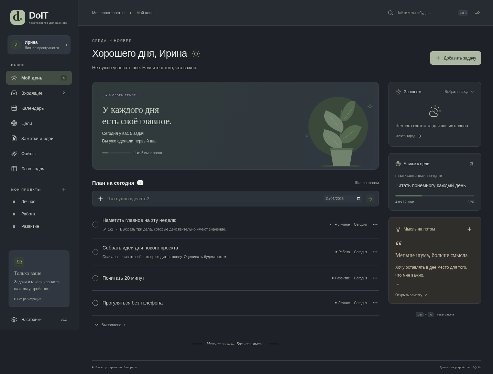
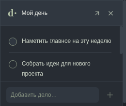

# DoIT 0.2

Личное приложение для Windows: задачи, планы и мысли в спокойном интерфейсе. Бесплатный локальный аккаунт с паролем, пять тем и настольные виджеты.

**[Скачать установщик Windows 10/11 x64 — DoIT-Setup-0.2.0-x64.exe](https://github.com/IljaVibe/DoIT/raw/refs/heads/downloads/windows-v0.2.0/DoIT-Setup-0.2.0-x64.exe)**

[Страница загрузки и контрольная сумма](https://github.com/IljaVibe/DoIT/tree/downloads/windows-v0.2.0)



## Установка и обновление

1. Скачайте EXE и запустите мастер установки. Архивы, BAT, Node.js и интернет при установке не требуются.
2. Выберите папку. Установка работает для текущего пользователя и создаёт ярлыки.
3. Создайте локальный аккаунт или продолжите без аккаунта.
4. Перед обновлением полностью выйдите из DoIT через меню значка в трее. Установщик не завершает работающий процесс принудительно.

Первая сборка не подписана цифровым сертификатом: Windows может показать предупреждение об неизвестном издателе. Сам мастер установки и интеграция с Windows требуют проверки на настоящей Windows; в доступной среде приложение проверялось в Linux Electron.

Обновление и удаление приложения сохраняют данные в `%APPDATA%\DoIT`. В деинсталляторе нет удаления этой папки. На всякий случай перед обновлением сохраните резервную копию через настройки.

## Аккаунт и сохранность после переустановки

Аккаунт **локальный**, без входа по почте и сервера. Пароль нужен при каждом запуске; пароль и ключ не сохраняются для автоматического входа. База и вложения аккаунта шифруются AES-256-GCM, ключ выводится из пароля через scrypt. Имена аккаунтов доступны на экране входа. Гостевой режим остаётся незашифрованным.

- После переустановки **DoIT** на том же профиле Windows аккаунт остаётся на компьютере.
- После переустановки **Windows**, потери диска или перехода на другой компьютер нужны **файл резервной копии `.doit` и пароль**.
- В настройках выберите папку копий в OneDrive или другом облачном диске. DoIT пишет зашифрованный файл; синхронизацию выполняет приложение облачного диска. DoIT не проверяет, загрузился ли файл в облако: дождитесь статуса синхронизации самого диска.
- Копия обновляется через 10 секунд после изменений и при полном выходе. Хранятся последняя и предыдущая версии. В настройках видны дата последней записи и ошибки доступа к папке.
- Ручная копия через «Сохранить копию» включает документы.
- Восстановление: экран входа → **«Из копии»** → пароль → файл `.doit`. Можно выбрать файл из облачного диска после его загрузки на компьютер.
- Без пароля восстановление невозможно; сброса через почту нет. Совпадение с существующим ID создаёт дополнительный восстановленный профиль и не перезаписывает прежний.

Облачной синхронизации активных сессий между несколькими компьютерами нет. Копия — средство восстановления, а не общий диск SQLite. Приложение и локальные аккаунты бесплатны; облачный диск предоставляет свои квоты и тарифы.

### Обновление с версии 0.1

Старые записи доступны через «Продолжить без аккаунта». При создании аккаунта выберите копирование текущих записей: задачи, заметки, цели и документы попадут в защищённое пространство. Исходные гостевые записи сохраняются без шифрования — перенос их автоматически не удаляет. Старые ZIP-копии можно импортировать через настройки. Для восстановления защищённого аккаунта используйте `.doit` на экране входа.

## Темы, запуск и фон

В настройках доступны **Шалфей, Песок, Туман, Лаванда и Графит**. Тема сохраняется с записями и применяется к виджетам.

- **Автозапуск Windows:** после установки DoIT появляется в трее при входе в Windows. Аккаунт остаётся заблокирован до ввода пароля. Опцию можно выключить.
- **Закрытие в трей:** крестик скрывает основное окно. Полный выход — значок DoIT рядом с часами → «Выйти из DoIT». По умолчанию опция выключена.
- **Виджеты:** задачи на сегодня, прогресс целей и заметка с быстрым вводом. Это небольшие отдельные окна, а не интеграция с системной панелью Windows Widgets. Они перемещаются за заголовок и меняют размер; положение сохраняется.
- Виджеты могут оставаться поверх других окон. Без закрепления ведут себя как обычные окна рабочего стола. Они не встраиваются в слой обоев.
- Из виджета можно добавить и завершить задачу, продвинуть цель и записать мысль. Изменения появляются в основном окне.
- Виджеты скрываются при блокировке аккаунта. Для работы при закрытом основном окне включите трей. При полном выходе приложение и виджеты завершаются.



## Остальные возможности

Задачи, подзадачи, приоритеты и проекты; раздел «Мой день»; календарь; измеримые цели; заметки и идеи; закрепление; поиск; файлы со связью с задачами; база задач в виде таблицы с фильтрами.

`Ctrl+N` — новая задача, `Ctrl+K` — поиск, `Esc` — закрыть редактор. При несохранённых изменениях редактор спросит о закрытии.

Погода получает данные Open-Meteo по выбранному городу: нужны интернет и доступ к `geocoding-api.open-meteo.com` и `api.open-meteo.com`. Ключ не требуется; геолокация и содержимое записей не передаются. Живой прогноз в этой cloud-среде блокируется сетевой политикой; обработка прогноза проверяется тестовыми ответами.

## Хранилище и ограничения

На Windows: `%APPDATA%\DoIT`. Гостевые данные — `doit.sqlite` и `attachments`; аккаунты — `accounts/<id>/doit.vault` и зашифрованные вложения. Индекс аккаунтов и настройки устройства хранят метаданные без паролей. Ключи существуют в памяти только во время открытой сессии.

Для открытия документа во внешней программе создаётся временная расшифрованная копия. DoIT удаляет её при блокировке/выходе, если файл не удерживается другой программой. После открытия конфиденциального документа закройте внешнюю программу. Потерянный пароль нельзя восстановить.

До 100 МБ на вложение и 250 МБ распакованных данных на резервную копию. Документы копируются в хранилище DoIT, поэтому перемещение оригинала не влияет на запись. Неиспользуемые вложения пока не очищаются физически и не включаются в новые копии.

Повторяющихся задач, системных напоминаний, совместных проектов и автоматического обновления пока нет. Перед будущим обновлением сохраняйте копию.

## Разработка и проверка

Стек: Electron, React, TypeScript, Vite, SQL.js/SQLite и Zod. Рекомендуется Node.js 24 LTS.

```sh
npm ci
npm run desktop
```

`npm run dev` запускает веб-режим с localStorage. Аккаунты, копии, погода, трей и виджеты доступны в настольной версии. При HTTPS-прокси установочный скрипт Electron использует прокси и доверенный CA; TLS-проверки не отключаются.

```sh
npm run build          # TypeScript и production-интерфейс
npm test               # 9 тестов SQLite, миграции, шифрования и копий
npm run test:ui        # прежние пользовательские сценарии
npm run test:desktop   # гостевой профиль, документы и ZIP
npm run test:accounts  # аккаунты, темы, копии, три виджета, блокировка и восстановление
npm run dist:win       # Windows-приложение и обычный офлайн NSIS-установщик
npm run dist:linux     # Linux-пакет для интеграционных проверок
```

На Linux UI-тест использует `/usr/bin/chromium`; другой путь задаётся через `CHROMIUM_PATH`. Для Windows тестовый Chromium устанавливается командой `npm exec -- playwright-core install chromium`.

Упакованное приложение проверяется через `DOIT_EXECUTABLE=/path/to/app npm run test:accounts` и `npm run test:desktop` с той же переменной. В headless Linux тесты используют `--no-sandbox` только для тестового процесса; обычный запуск этот флаг не добавляет. Трей отключается, если в Linux нет графического дисплея.

### Установщик

`scripts/build-installer.cjs` использует официальные, проверяемые по контрольным суммам NSIS и 7-Zip из electron-builder. Собственный NSIS-сценарий создаёт деинсталлятор при установке, поэтому Wine для сборки не нужен. Установщик проверяет SHA256 вложенного архива, не требует администратора и не завершает работающий DoIT принудительно. Деинсталлятор удаляет только известные файлы приложения и ярлыки; пользовательские данные в APPDATA сохраняются. Исходный сгенерированный NSIS-сценарий доступен в `release/installer.generated.nsi` после сборки.

## Следующие этапы

Ручная проверка установки, трея и автозапуска на Windows; цифровая подпись; повторяющиеся задачи и напоминания; очистка старых вложений. Серверную синхронизацию можно добавить отдельно, если она понадобится.
