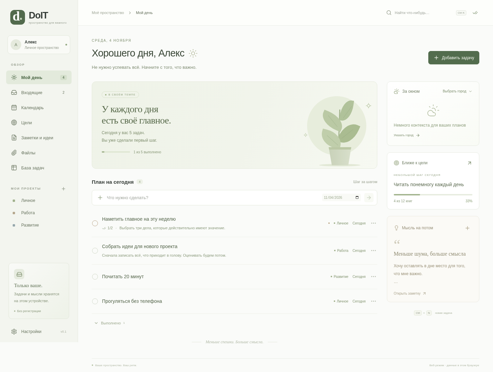

# DoIT

Личное приложение для Windows: задачи, планы и мысли в одном спокойном пространстве. Без аккаунта и обязательного подключения к интернету.



## Запуск готовой версии

1. Скачайте `DoIT-0.1.0-Windows-x64.zip` из папки `release`.
2. Распакуйте **весь архив** в отдельную папку. Не запускайте EXE прямо из ZIP и не переносите его отдельно от остальных файлов.
3. Откройте `DoIT.exe`. Node.js и другие инструменты на вашем компьютере не нужны.
4. Начните с пустого пространства или выберите демонстрационные записи. Примеры можно добавить и позже в настройках.

Требуется Windows 10/11, x64. Это первая, неподписанная сборка: Windows может показать предупреждение о неизвестном издателе. Проверка запуска на настоящей Windows ещё необходима; в этой среде настольное приложение проверялось на Linux.

## Что работает

- **Мой день:** план на сегодня, прогресс, завершённые и просроченные задачи.
- **Задачи:** быстрый ввод, даты, приоритеты, описания, подзадачи и проекты. Входящие — задачи без даты.
- **Календарь:** месяц и дела на выбранный день; изменение даты через детали задачи.
- **Цели:** измеримый результат, срок и ручное обновление прогресса.
- **Заметки и идеи:** отдельные записи, закрепление, поиск. Обычный текст, без сложного редактора.
- **Файлы:** собственные копии документов, связь с задачей, открытие внешней программой. До 100 МБ на документ. Запуск исполняемых файлов из приложения отключён.
- **База задач:** таблица с фильтрами по статусу и проекту, сортировка. Это единая база задач, а не конструктор произвольных таблиц как в Notion.
- **Поиск** по задачам, заметкам, целям и именам документов.
- **Погода:** выбранный город, текущая температура и диапазон на день через Open-Meteo. Нужен интернет, ключ не требуется. Обновление раз в 30 минут; при ошибке доступен повторный запрос. Геолокация не запрашивается.
- **Резервные копии:** ZIP с данными и документами, экспорт и восстановление с подтверждением замены. До 250 МБ распакованных данных.

Сочетания клавиш внутри приложения: `Ctrl+N` — новая задача; `Ctrl+K` — поиск; `Esc` — закрыть окно редактирования. Если есть несохранённые изменения, DoIT спросит о закрытии.

## Где лежат данные

На Windows: `%APPDATA%\DoIT\doit.sqlite` и `%APPDATA%\DoIT\attachments`. Обновление папки приложения не должно затрагивать это хранилище; перед обновлением сохраняйте резервную копию через настройки.

Записи автоматически сохраняются в SQLite. Индикатор вверху показывает состояние сохранения. Если возникла ошибка, повторите сохранение до закрытия приложения. Вложения копируются: перемещение оригинала не повлияет на копию DoIT.

Данные и резервные копии **не зашифрованы**. Удалённые из списка вложения исключаются из новых резервных копий, но физическая очистка неиспользуемых файлов в версии 0.1 не выполняется. Поэтому хранилище может занимать больше места, чем показывает список активных вложений.

Облачной синхронизации, общих проектов, системных напоминаний, повторяющихся задач и автoобновления пока нет. Остальные функции работают без интернета. Погода обращается только к `geocoding-api.open-meteo.com` и `api.open-meteo.com`; содержимое задач и заметок туда не передаётся.

## Разработка

Стек: Electron, React, TypeScript, Vite, SQL.js (SQLite), Zod. Интерфейс изолирован от Node.js; доступ к файлам идёт через ограниченный preload-мост и системные диалоги.

```sh
cd /workspace/DoIT
npm ci
npm run desktop
```

Рекомендуется Node.js 24 LTS. Для веб-разработки: `npm run dev`. В браузере данные сохраняются в localStorage; вложения, резервные копии и погода доступны в настольном режиме. На машине с HTTP-прокси для загрузки Electron может потребоваться `ELECTRON_GET_USE_PROXY=1 node node_modules/electron/install.js` с установленным доверенным CA, без отключения TLS-проверок.

```sh
npm run build          # TypeScript + production-сборка
npm test               # 4 проверки SQLite и схемы данных
npm run test:ui        # сквозной UI-тест, нужен Chromium
npm run test:desktop   # интеграция Electron: база, документы, копии, перезапуск
npm run dist:win       # ZIP для Windows x64
```

UI-тест использует `/usr/bin/chromium`; другой путь можно передать через `CHROMIUM_PATH`. Desktop-тест по умолчанию использует headless Linux; флаг `--no-sandbox` относится только к изолированному тестовому процессу. Обычный запуск приложения этот флаг не использует. Проверить упакованную Linux-версию можно через `DOIT_EXECUTABLE=/path/to/executable npm run test:desktop` после `npm run dist:linux`.

## Проверено в текущей среде

- Проверка типов и production-сборка.
- 4 теста хранения: повторное открытие SQLite, Unicode/подзадачи, отклонение некорректных записей, дат, путей, прогресса и координат.
- Сквозной тест интерфейса: начальный экран, быстрый ввод, редактирование, подзадачи, завершение, сохранение после перезагрузки, входящие, календарь, цели, заметки, поиск, фильтры, проекты, настройки и ширина 1000 px.
- Настоящий Electron: ввод с клавиатуры, SQLite, копирование документа, экспорт и восстановление ZIP с вложением, отклонение опасного пути и сохранность данных после перезапуска.
- Погода проверена на тестовых ответах API. Живой запрос из cloud-среды отклонён сетевой политикой (HTTP 403); реальный прогноз здесь не подтверждён.

## Предлагаемые следующие этапы

1. **Обратная связь после использования:** проверить эту сборку на Windows, удобство размеров текста, календаря и ежедневного ввода.
2. **Ежедневные привычки:** повторяющиеся задачи, системные напоминания, обзор недели и необязательный таймер фокуса.
3. **Надёжность и распространение:** тестирование на Windows в CI, подписанный установщик, автоматические обновления, очистка старых вложений и шифрование копий.
4. **Несколько устройств:** отдельный проект синхронизации с авторизацией, разрешением конфликтов и защитой вложений.

Первую версию можно развивать без сторонних платных сервисов. Для подписи Windows-сборок нужен сертификат издателя; для синхронизации потребуется выбрать сервер и способ входа.
